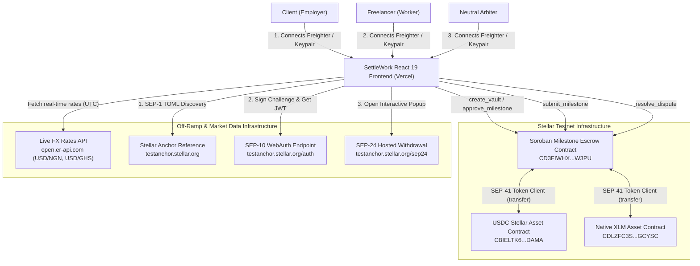

# SettleWork

[](https://stellar.org)
[](https://soroban.stellar.org)
[](https://settlework.vercel.app)
[](LICENSE)

> **Decentralized Milestone Escrow & African Fiat (NGN/GHS) Off-Ramp dApp built on Stellar Soroban.**

---

## Quick Links

- 🌐 **Live Web Application**: [https://settlework.vercel.app](https://settlework.vercel.app)
- 📜 **Deployed Soroban Contract (StellarExpert)**: [`CD3FIWHXN3XZCKAHVEKNBTMAAW7C4LOIW3BBIQPNH654SL2DX3MVW3PU`](https://stellar.expert/explorer/testnet/contract/CD3FIWHXN3XZCKAHVEKNBTMAAW7C4LOIW3BBIQPNH654SL2DX3MVW3PU)
- 🐙 **GitHub Repository**: [https://github.com/JimmyOgb/settlework](https://github.com/JimmyOgb/settlework)

---

## 1. Overview & Real-World Problem

Cross-border freelance and agency contracts between global clients and African developers (especially in **Nigeria** and **Ghana**) suffer from severe structural friction:
1. **High Counterparty Risk**: Clients fear paying up front and receiving sub-par work; freelancers fear delivering work and getting ghosted or stiffed.
2. **Exorbitant Wire Fees & Delayed Settlements**: Traditional bank SWIFT wires charge **$35–$65 flat fees plus 4–7% FX rate markups**, taking **3 to 5 business days** to arrive.
3. **Account Freezes & High Platform Cuts**: Web2 platforms (Upwork, Fiverr) charge 10–20% commissions and hold payouts for 14-day clearance periods, frequently freezing African accounts unexpectedly.

### The SettleWork Solution
SettleWork solves this by pairing **Soroban milestone escrow smart contracts** with **Stellar Asset Contracts (SAC)** and **Stellar Anchor fiat off-ramps (SEP-10 / SEP-24 / SEP-38)**:
- **Trustless Funding**: Clients lock funds (USDC or XLM) directly into the Soroban contract before work starts.
- **Milestone-Based Releases**: Freelancers submit verifiable deliverable proofs (GitHub commit/PR links or IPFS hashes) and clients release payments with 1-click on-chain approval.
- **Impartial Arbitration**: Impartial arbiters adjudicate contested deliverables to either release funds to the freelancer or refund the client.
- **Seconds-Fast Local Fiat Off-Ramps**: Freelancers convert released USDC directly into Nigerian Naira (NGN via NIP Instant Bank Transfer) or Ghanaian Cedis (GHS via MTN Mobile Money) at transparent, live market FX rates with **< $0.001 network fees**.

---

## 2. System Architecture



---

## 3. How to Use SettleWork (Step-by-Step Guide)

### Connecting & Funding (Testnet)
1. Open [https://settlework.vercel.app](https://settlework.vercel.app).
2. Click **Connect Wallet** in the top navigation:
   - **Option A (Freighter Extension)**: Connect your browser extension (set your network to **Testnet** in Freighter settings).
   - **Option B (Direct Testnet Keypair)**: Click *Generate New Funded Account (+10,000 XLM)* to instantly spawn an active Testnet identity funded via Friendbot, or import an existing `S...` secret key.
3. Need testnet funds? Click the **Faucet** button in the header at any time for +10,000 XLM.

### As a Client (Creating & Managing Vaults)
1. Switch to the **Client View** using the top navigation pill.
2. Click **Create Escrow Vault**:
   - Choose your asset: **USDC** (Stellar SAC) or **Native XLM**.
   - Input the **Freelancer Stellar Address** (`G...`) and **Arbiter Stellar Address** (`G...`).
   - Define your milestone schedule (e.g., Milestone 1: $50 / 7 days; Milestone 2: $50 / 14 days).
   - Click **Confirm & Lock Funds**. Sign the transaction in Freighter or via your keypair.
3. Inspect active vaults:
   - View submitted deliverables and verify the live proof link.
   - Click **Approve & Release** (`approve_milestone`) to release milestone funds to the freelancer on-chain in ~5 seconds.
   - If work is stalled or contentious, click **Raise Dispute** (`raise_dispute`) to freeze funds and request Arbiter adjudication.
   - If a deadline has passed without deliverable submission, click **Claim Refund** (`refund_expired`).

### As a Freelancer (Submitting Deliverables & Cashing Out)
1. Switch to the **Freelancer View**. Contracts naming your address appear automatically.
2. Click **Submit Deliverable** on an active milestone:
   - Enter your deliverable proof (GitHub PR URL, commit hash, or demo URL).
   - Confirm submission to record the deliverable reference permanently on-chain.
3. Once the client approves, your earnings update in real time.
4. Click **Withdraw to NGN / GHS**:
   - Toggle between **Nigeria (NGN — NIP Bank Transfer)** and **Ghana (GHS — MTN Mobile Money)**.
   - View live FX conversion rates fetched directly from `open.er-api.com` with UTC timestamp.
   - Review transparent fees (< $0.001 network fee vs. ~$45 + 5.5% on traditional bank wires).
   - Click **Initiate Anchor Withdrawal on Testnet (SEP-24)**: SettleWork performs a **SEP-10 challenge-response authentication** with `testanchor.stellar.org`, issues a Bearer JWT, and opens the official anchor interactive popup window for final local banking fulfillment.

### As an Arbiter (Resolving Disputes)
1. Switch to the **Arbiter Console**.
2. Any milestone where the client or freelancer raised a dispute appears under *Pending Disputes Requiring Ruling*.
3. Review the client address, freelancer address, and submitted deliverable evidence.
4. Execute final settlement:
   - **Release to Freelancer** (`resolve_dispute` with `release_to_freelancer: true`)
   - **Refund to Client** (`resolve_dispute` with `release_to_freelancer: false`)

---

## 4. Smart Contract Specification (`contracts/escrow`)

The contract is implemented in Rust using `soroban-sdk v22.0.8` and compiled to WebAssembly target `wasm32v1-none`.

### Milestone Lifecycle

```
[Pending] ------ submit_milestone (Freelancer) -----> [Submitted]
    |                                                      |
    +--- approve_milestone (Client early release) ---------+---> [Approved] (Funds released)
    |                                                      |
    +--- refund_expired (Client, if deadline passed)       +---> [Refunded] (Funds returned)
    |                                                      |
    +--- raise_dispute (Client or Freelancer) -------------+---> [Disputed] (Frozen)
                                                                   |
                                      resolve_dispute (Arbiter) ---+---> [Approved] OR [Refunded]
```

### Core Functions & Authorization

| Function | Signer Required (`require_auth`) | State Check | Description |
| :--- | :--- | :--- | :--- |
| `create_vault(...) -> u64` | `client` | Non-zero amount, distinct addresses | Deducts total tokens via SAC `transfer` from `client` into escrow contract; stores vault and indexes under client and freelancer. |
| `submit_milestone(...)` | `freelancer` | Status == `Pending` | Updates deliverable URL/hash and updates status to `Submitted`. |
| `approve_milestone(...)` | `client` | Status == `Submitted` or `Pending` | Releases `milestone.amount` from contract to `freelancer` via SAC `transfer`; sets status to `Approved`. |
| `raise_dispute(...)` | `client` or `freelancer` | Status == `Pending` or `Submitted` | Freezes milestone in `Disputed` state. |
| `resolve_dispute(...)` | `arbiter` | Status == `Disputed` | Transfers funds to `freelancer` (`Approved`) or refunds `client` (`Refunded`). |
| `refund_expired(...)` | `client` | Status == `Pending` && `ledger.timestamp > deadline` | Returns milestone amount to `client`; sets status to `Refunded`. |
| `get_vault(vault_id)` | *None (Read-only view)* | None | Returns complete `Vault` struct. |
| `get_client_vaults(client)` | *None (Read-only view)* | None | Returns vector of `vault_id`s created by client. |
| `get_freelancer_vaults(freelancer)` | *None (Read-only view)* | None | Returns vector of `vault_id`s assigned to freelancer. |

### Storage TTL Management
- Uses **Persistent Storage** for all vaults and index vectors.
- Implements automatic TTL extension (`extend_ttl`) on every write and read using a threshold of **30 days** (`518,400 ledgers`) and bumping to **120 days** (`2,073,600 ledgers`) per Soroban state archival best practices.

---

## 5. Live Testnet Verification Proof

A full end-to-end milestone lifecycle was executed and verified live on Stellar Testnet against contract `CD3FIWHXN3XZCKAHVEKNBTMAAW7C4LOIW3BBIQPNH654SL2DX3MVW3PU`:

| Action | Participant & Execution | Live StellarExpert Testnet Link |
| :--- | :--- | :--- |
| **1. `create_vault`** | Client (`GBI5GJDHP...`) locked 100 XLM into escrow across 2 milestones | [Tx: `e967883477e2f...`](https://stellar.expert/explorer/testnet/tx/e967883477e2f4d376a806f161ff9dc392d8e13972c72c53ff234e67b03a02b5) |
| **2. `submit_milestone`** | Freelancer (`GDUVERX6G...`) submitted deliverable URL for Milestone 1 | [Tx: `01d7435d66371...`](https://stellar.expert/explorer/testnet/tx/01d7435d663715f540baa64da323f24fd2f19ce317b56bbf8a65a370c4932b2c) |
| **3. `approve_milestone`** | Client (`GBI5GJDHP...`) approved Milestone 1; contract released 50 XLM on-chain | [Tx: `a478f2a0448ca...`](https://stellar.expert/explorer/testnet/tx/a478f2a0448ca419e102a5016f9407d8669f5c7df9c90e598fa8bf52eef8adf5) |

**On-Chain Verification State:**
- Vault ID 1 state: Milestone 1 is `Approved` (status 3), Milestone 2 is `Pending` (status 1).
- Freelancer balance verified on Horizon: updated to **`10,049.9748576 XLM`** (reflecting the 50 XLM contract release).

---

## 6. Zero-Mock Architecture Table

SettleWork operates under a strict Zero-Mock, Zero-Hardcode policy:

| Service / Layer | Live Endpoint | Purpose |
| :--- | :--- | :--- |
| **Stellar RPC Server** | `https://soroban-testnet.stellar.org` | Smart contract simulation, submission & transaction polling |
| **Stellar Horizon Server** | `https://horizon-testnet.stellar.org` | Native XLM and SEP-41 token balance querying |
| **Stellar Faucet** | `https://friendbot.stellar.org` | 1-Click live Testnet account funding (+10,000 XLM) |
| **Live FX Exchange Feed** | `https://open.er-api.com/v6/latest/USD` | Real-time USD/NGN and USD/GHS market rates (fails loudly if unavailable) |
| **Anchor SEP-1 TOML** | `https://testanchor.stellar.org/.well-known/stellar.toml` | Anchor endpoint discovery and signing key lookup |
| **Anchor SEP-10 Auth** | `https://testanchor.stellar.org/auth` | Challenge-response WebAuth signing & JWT token issuance |
| **Anchor SEP-24 Off-Ramp** | `https://testanchor.stellar.org/sep24` | Interactive hosted withdrawal session generation & status polling |

---

## 7. Local Development & Testing

### Prerequisites
- [Rust](https://rustup.rs/) (>= 1.84) with `wasm32v1-none` target
- [Node.js](https://nodejs.org/) (>= 20.x)
- [Stellar CLI](https://developers.stellar.org/docs/tools/developer-tools/cli) (>= 30.0.1)

### 1. Smart Contract Tests & Build
```bash
# Run contract unit tests (all 9 unit tests with mock SAC tokens)
cargo test --lib

# Compile optimized WebAssembly bytecode (~13 KB)
stellar contract build
```

### 2. Frontend Development
```bash
cd web

# Install dependencies
npm install

# Start local development server
npm run dev

# Production build verification
npm run build
```

---

## 8. 30-Day Stellar Community Fund (SCF) Roadmap

- **Week 1 (Mainnet Deployment & Audit)**: Security audit of Soroban Escrow contract; deploy contract to Stellar Public Network; resolve Mainnet USDC SAC (`GA5ZSEJYB37JRC5AVCIA5MOP4RHTM335X2KGX3IHOJAPP5RE34K4KZVN`).
- **Week 2 (Anchor Partnerships)**: Integrate production SEP-24/SEP-38 corridors with regional anchors (e.g., Yellow Card / LinkIO / Cowrie) for instant NGN bank transfers and GHS mobile money.
- **Week 3 (Multi-Token Expansion & Notifications)**: Add support for EURC and native USDT0 (LayerZero V2); implement automated email/webhook notifications for milestone submissions and dispute alerts.
- **Week 4 (Developer SDK & Widget)**: Ship `@settlework/sdk` and an embeddable React checkout widget allowing freelance marketplaces (e.g., Superteam, Web3 job boards) to integrate milestone escrow payments in 3 lines of code.

---

## License

This project is licensed under the [Apache License 2.0](LICENSE).
